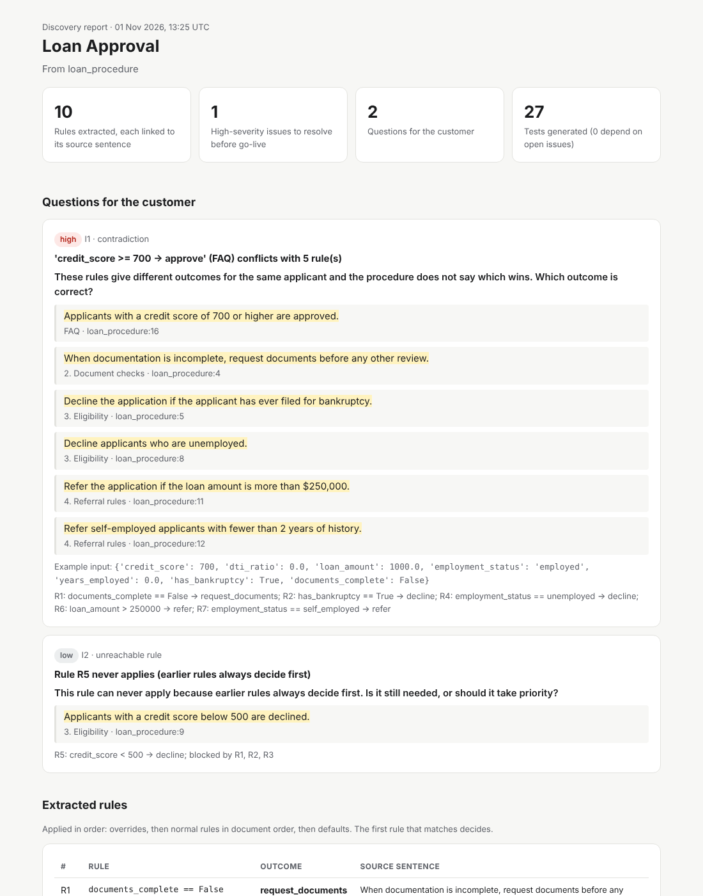
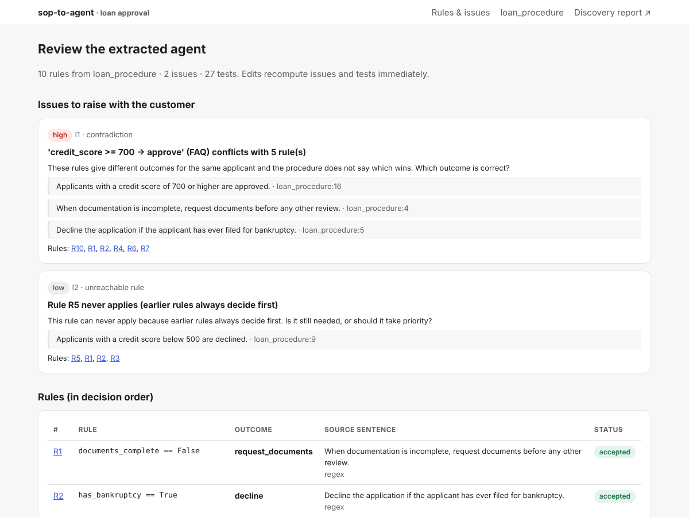
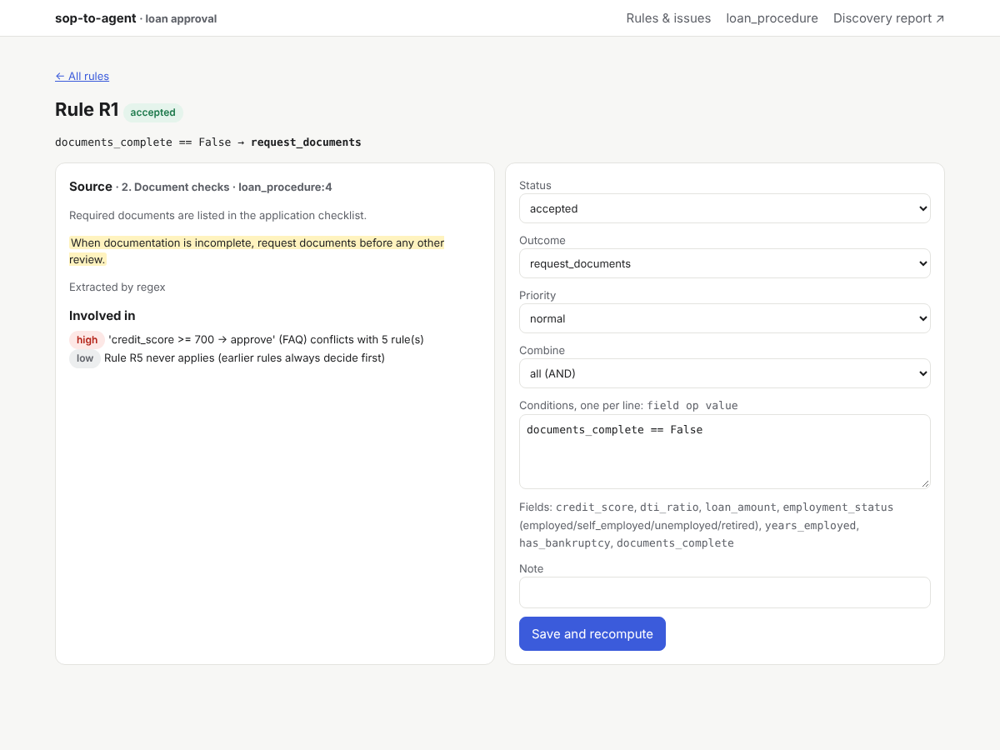

# sop-to-agent

**Turn a customer's process documents into an agent spec you can trace, a list of questions to ask the
customer, and a test set: before the agent ever goes live.**

When a Forward Deployed Engineer starts at a customer, the first weeks go into reading SOPs, policies
and FAQs and turning them into an agent by hand. Rules get missed, gaps in the documents only surface
in production, and tests come late or never.

`sop-to-agent` compiles the documents instead:

| Output | What it gives you |
|---|---|
| **Decision spec** (`spec.yaml`) | Ordered rules, each linked to the exact sentence it came from |
| **Discovery report** (`report.html`, `report.md`) | Contradictions, gaps, boundary mismatches, vague terms and unreachable rules, written as **questions for the customer** with the evidence quoted |
| **Test set** (`tests.jsonl`) | One case per rule, boundary cases at every threshold, and cases that illustrate each open issue |
| **Shadow Eval config** (`shadow_eval_domain.yaml`) | Plugs straight into [shadow-eval](https://github.com/Aravindhant07/shadow-eval) to prove the agent is ready to go live |



It runs **free on open-source models** downloaded from Hugging Face and run locally, with an instant
pattern-matching mode that needs no model at all.

## Design: small model jobs, verified by code

Small models contradict themselves and invent numbers; I measured that in
[shadow-eval](https://github.com/Aravindhant07/shadow-eval#real-open-model-results). So the model
never writes the agent. It does one small, checkable job: **one sentence in, one candidate rule out**.
Everything that must be reliable is deterministic code:

```
documents ─► sentences (IDs + offsets) ─► LLM or regex: one sentence → candidate rule
          ─► validate against the schema (unknown fields, values, outcomes are rejected, never guessed)
          ─► citation attached by code (the model cannot hallucinate a source)
          ─► compile to an ordered decision engine
          ─► analyse on a boundary-value grid: contradictions · gaps · boundary mismatches · unreachable rules
          ─► generate tests ─► export spec, report, tests, Shadow Eval config ─► review UI
```

How the analysis works (no model involved):

- **Boundary grid.** For every threshold `t` in any rule, it tests `t−1`, `t` and `t+1`, plus every enum
  and boolean value, across every rule.
- **Contradiction.** A rule from an FAQ, notes or appendix section, or from another document, gives a
  different outcome from the main procedure for the same input. Rules that merely restate a main rule
  are recognised and not flagged. Ordered cascades inside the main procedure are treated as intended.
- **Boundary mismatch.** One sentence says "over $250,000" and another says "$250,000 or more", so the
  outcome at exactly $250,000 is undefined.
- **Gap.** Inputs no rule decides. **Unreachable rule.** It never fires because earlier rules always decide first.
- **Vague term.** "High-risk", "unstable income" and similar terms in requirement sentences.

## Quick start (free, offline, instant)

```bash
git clone https://github.com/Aravindhant07/sop-to-agent && cd sop-to-agent
pip install -e .
sop2agent demo --serve        # compiles examples/loan with the regex extractor, opens the review UI
```

Your own documents:

```bash
sop2agent schema my_sop.md --provider local -o schema.yaml     # model proposes outcomes and inputs; edit it
sop2agent compile my_sop.md policy.pdf faq.md -s schema.yaml -e local -m Qwen/Qwen2.5-3B-Instruct -o out
sop2agent serve --out out                                      # review rules next to their source sentences
```

| Extractor (`-e`) | Cost | Notes |
|---|---|---|
| `regex` | free, instant | Uses the field and outcome phrases in `schema.yaml`. Brittle on paraphrase |
| `local` | free | Open model from Hugging Face, run on your machine (`pip install -e ".[local]"`) |
| `ollama` | free | Any Ollama model running locally |
| `hf` | HF credits | Hugging Face Inference Providers (`HF_TOKEN`) |
| `claude` | paid | `pip install -e ".[claude]"`, `ANTHROPIC_API_KEY` |

## Benchmark

`sop2agent benchmark` scores an extractor on four synthetic loan-approval SOPs. They are generated from
a **known rule set** in different wording, with **planted problems**: a contradicting FAQ answer, an
inclusive/exclusive boundary mismatch, vague terms, a missing default rule (gap) and an unreachable rule.
SOP D is **held out**: conversational wording ("people who are out of work are turned down") that none
of the patterns or prompt examples were written for.

- **Decision agreement:** % of boundary-grid inputs where the extracted engine decides like the true one.
- **Rule recall:** % of true rules recovered *exactly* (right sentence, same outcome, same behaviour on every input).
- **Issue recall / precision:** planted issues found / reported issues that are real.

| Extractor | Decision agreement | Rule recall | Issue recall | Issue precision | False rules | Time (CPU) |
|---|---|---|---|---|---|---|
| `regex` (baseline, no model) | 57.7% | 47.9% | 66.7% | 87.5% | 0 | instant |
| `local` Qwen2.5-1.5B-Instruct | 50.0% | **76.7%** | **91.7%** | 17.1% | 10 | 41 min |

What the numbers say:

- **The model reads paraphrase that patterns cannot.** On the held-out conversational SOP (D), rule recall
  goes from 0% (regex) to 67%, and planted-issue recall goes from 1/3 to 3/3.
- **One hallucinated rule can sink the whole agent.** The model also turned scope and filler sentences
  into rules. "Required documents are listed in the application checklist" became "documents complete →
  approve". Because it comes early in the document, that rule decides first for half of all inputs, so
  decision agreement is exactly 50% even though 77% of the rules are right. The false rules also create
  false contradiction alerts, hence the low issue precision.
- **That is the design working as intended.** Every rule is shown next to the sentence it came from, so a
  reviewer rejects "documents complete → approve" (cited from *"Required documents are listed in the
  application checklist."*) in one click, and the engine and tests recompute. Small local models make
  the review step essential, not optional.

Per-variant details: [`docs/results/`](docs/results/).

## Review UI

| Issues and rules | One rule against its source |
|---|---|
|  |  |

`sop2agent serve` shows every rule next to its highlighted source sentence. You can accept, reject or
edit a rule; issues and tests are recomputed and every output is rewritten immediately. Rejecting the
contradicting FAQ rule, for example, clears the contradiction.

## Project layout

```
sop_to_agent/
  ingest.py      documents → sentences with IDs, sections and offsets
  spec.py        inputs, outcomes, rules, citations
  expr.py        safe condition evaluation, validation, normalisation
  engine.py      ordered first-match decision engine
  analyze.py     contradictions, gaps, boundary mismatches, unreachable rules, vague terms
  testgen.py     test cases with expected outcomes
  extract/       regex baseline · one-sentence LLM extractor · schema discovery
  llm.py         local Hugging Face · Ollama · HF API · Claude backends
  export.py      spec, report, tests, Shadow Eval config
  web/           review UI (FastAPI)
  bench/         synthetic loan SOPs and scoring
docs/            PROBLEM.md · REQUIREMENTS.md · DESIGN.md · results/
```

## Limitations

- Conditions are flat (all-of / any-of). Deeply nested logic needs manual editing in the review UI.
- Contradiction detection treats document order inside the main procedure as intentional; it flags
  conflicts that come from FAQ/notes/appendix sections or other documents.
- The benchmark is synthetic. Real SOPs are messier, which is why every rule is reviewable.

## License

MIT
